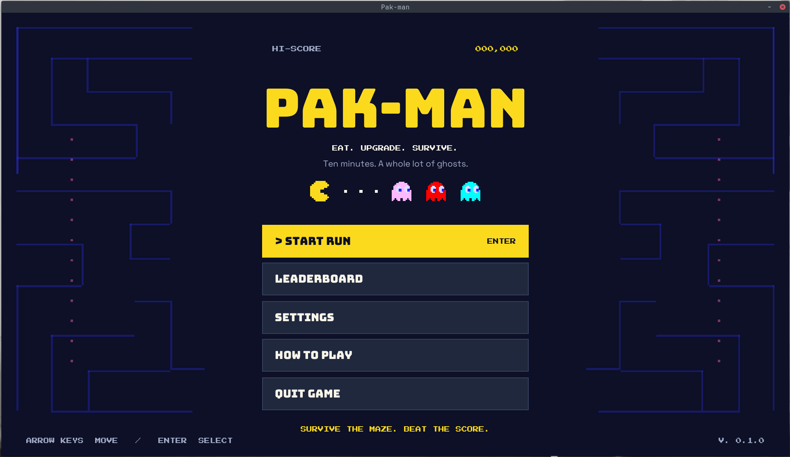
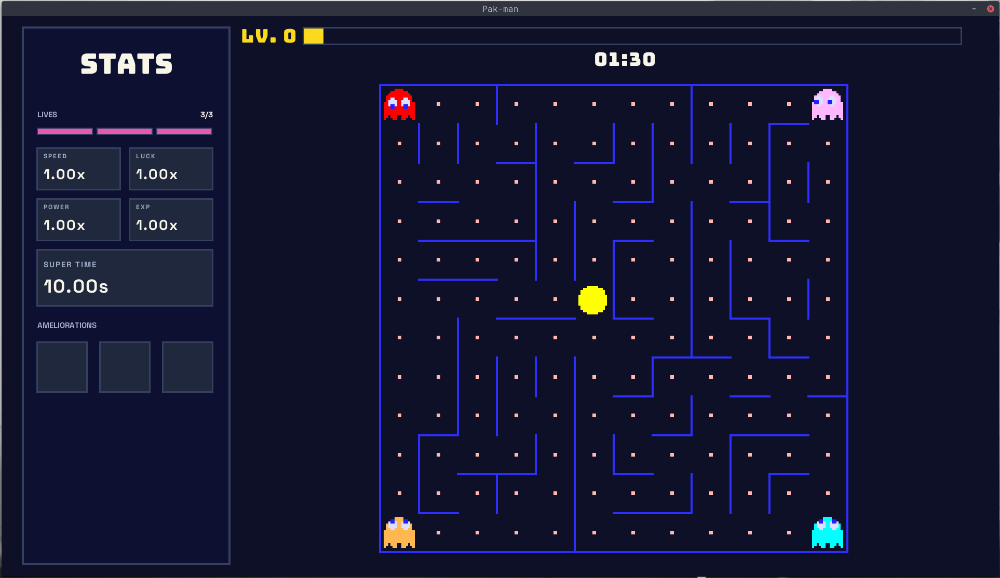
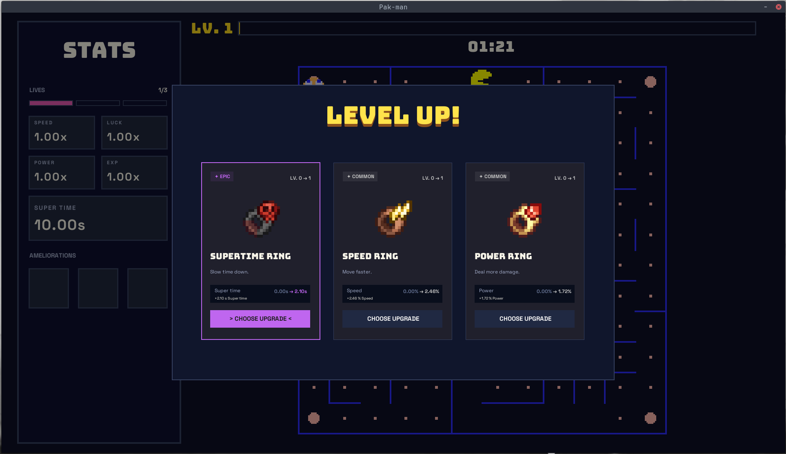
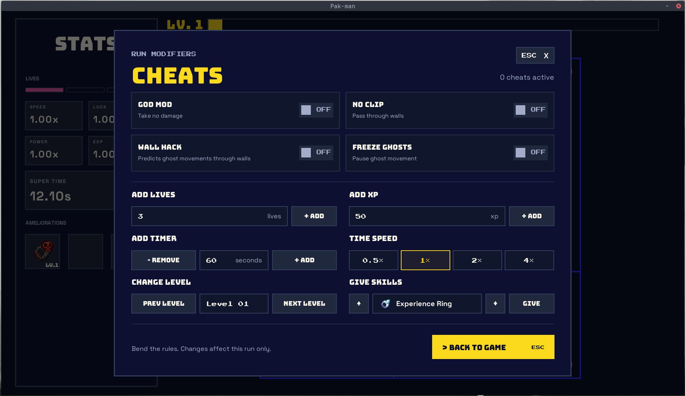
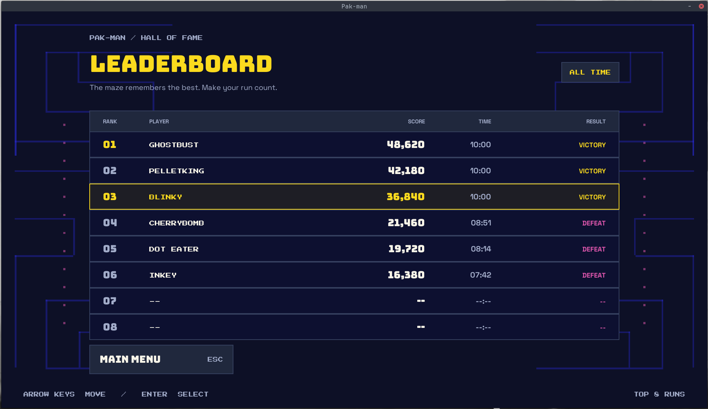
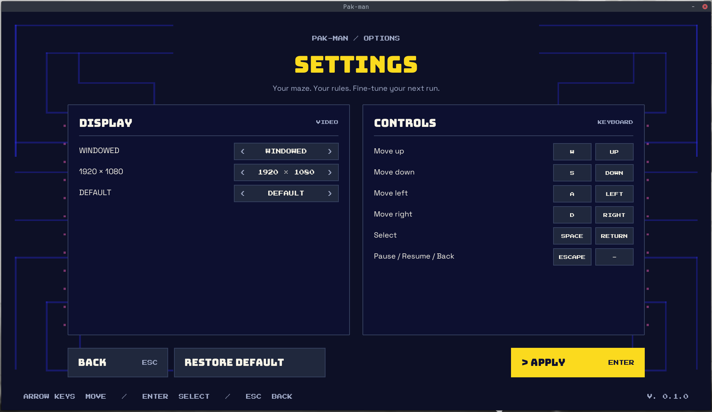
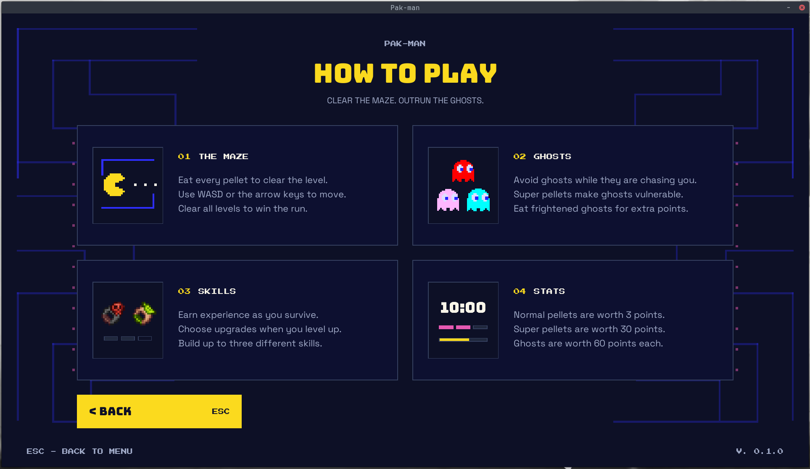
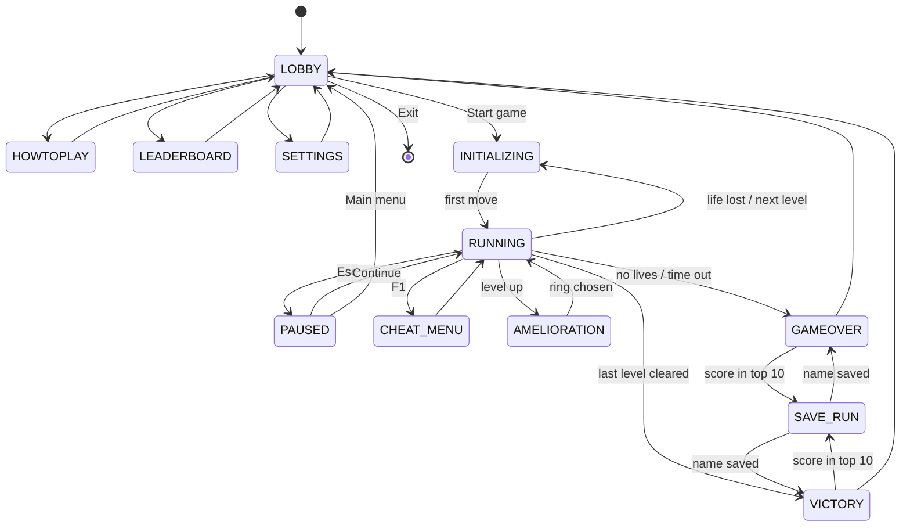
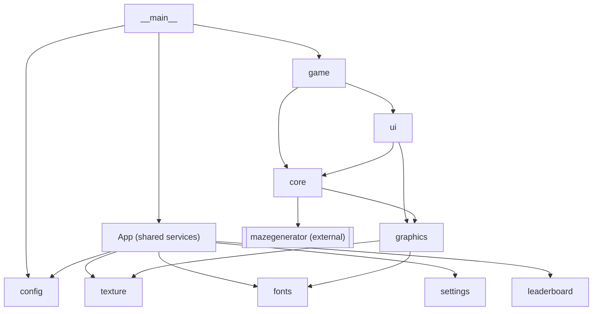
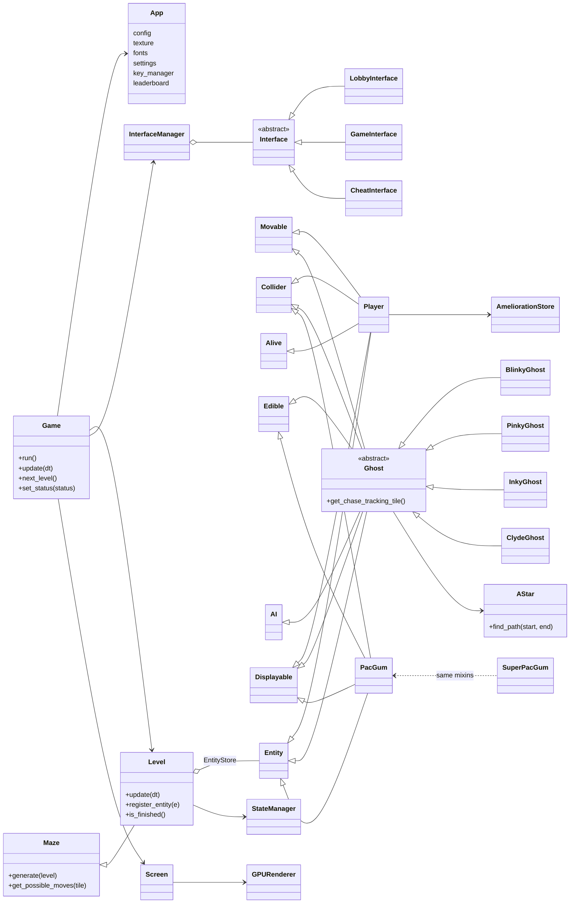

*This project has been created as part of the 42 curriculum by rpetit, lgirard.*

# Pak-Man

> Ghosts! More ghosts! - a modern, GPU-rendered take on the 1980 arcade classic, written in Python.



| In game | Level up |
| :---: | :---: |
|  |  |
| **Cheat menu** | **Leaderboard** |
|  |  |
| **Settings** | **How To Play** |
|  |  |

**Play it:** https://69nesta.itch.io/pak-man

**Design mockups (Figma):** [42 - Pakman](https://www.figma.com/design/cSfGNa7qtEZC10juktc8Ys/42---Pakman?node-id=0-1&t=foPbcMUUIEDrhbBq-1)

---

## Table of contents

- [Description](#description)
- [Instructions](#instructions)
- [Controls & cheat mode](#controls--cheat-mode)
- [Configuration](#configuration)
- [Highscore](#highscore)
- [Maze Generation](#maze-generation)
- [Implementation](#implementation)
- [General Software Architecture](#general-software-architecture)
- [Project Management](#project-management)
- [Resources](#resources)

---

## Description

**Pak-Man** is a complete, playable Pac-Man game built in Python with object-oriented
programming and a modular architecture. The goal of the 42 project is to recreate the
arcade game with:

- a **configurable** game (JSON file with comments, robust to any faulty value),
- **levels generated by an external A-Maze-ing package** written by another group,
- a **persistent top-10 highscore** system,
- a **polished graphical UI** (main menu, HUD, pause, game over, victory),
- a **cheat mode** to help peer evaluation,
- a **packaged build** published on a public gaming platform (itch.io).

### Game loop

`Main menu → Start game → Win or Lose → Enter name for highscore → Back to main menu`

### Features

- 10 levels by default (fully configurable). Level 1 uses seed `42`; the next ones are random.
- 4 ghosts, each with its own personality, path-finding with **A\***:
  - **Blinky** (red) chases the player directly,
  - **Pinky** (pink) ambushes 4 tiles in front of the player,
  - **Inky** (cyan) targets the point symmetric to Blinky through the player,
  - **Clyde** (orange) wanders to random tiles on the maze border.
- Pacgums in every corridor, super-pacgums in the 4 corners: ghosts turn **frightened**
  (blue, edible, flee to random tiles), then go back to their corner as eyes and respawn.
- A timer per level (the run ends when it reaches 0), 3 lives, pause menu.
- **Rogue-lite progression** (our own addition): the player earns experience over time and by
  eating, and on each level-up picks one of 3 random **rings** (Speed, Exp, Luck, Power,
  Super-time) with a rarity from *Common* to *Mythic*. Up to 3 different rings per run.
- Custom **GPU renderer** (moderngl + GLSL shaders), resizable window and fullscreen.
- In-game **settings**: key rebinding, resolution, fullscreen, **texture packs**.
- Signed highscore file (HMAC-SHA256) to detect tampering.

---

## Instructions

### Requirements

- **Python ≥ 3.13**
- [**uv**](https://docs.astral.sh/uv/) (dependency manager)
- A GPU / driver supporting **OpenGL 3.3 core**

### Install & run

```bash
make install          # uv sync: creates .venv and installs dependencies (+ the maze wheel)
make run              # runs the game with ./config.jsonc
```

Equivalent commands:

```bash
uv run python3 pac-man.py config.jsonc   # usage required by the subject
uv run python3 -m src config.jsonc
make run CONFIG=path/to/other_config.json
```

The program takes **one argument**: the configuration file. A missing, unreadable or
invalid file never crashes the game: a clear message is logged and default values are used.

### Other Makefile rules

| Rule | Description |
| --- | --- |
| `make install` | Install dependencies with `uv sync` |
| `make run` | Run the game (`ARGS=` and `CONFIG=` can be overridden) |
| `make debug` | Run the game under `pdb` |
| `make lint` | `flake8` + `mypy` with the flags required by the subject |
| `make lint-strict` | `flake8` + `mypy --strict` |
| `make test` / `make test-verbose` | Run the `pytest` suite |
| `make build` | Build the standalone package with PyInstaller → `dist/pak-man/` + `dist/pac-man.zip` |
| `make clean` / `make fclean` | Remove caches / also remove `.venv` and saved data (`.pak-man/`) |

### Packaging

`make build` uses [`pak-man.spec`](pak-man.spec) (PyInstaller) to bundle the game, its
assets, its shaders and the default `config.jsonc` into `dist/pak-man/`, then zips it
into `dist/pac-man.zip`. This archive is the build uploaded to itch.io. Inside the package,
launch `pak_man` (optionally followed by a config file). Controls and rules are available
in game, from the **How to play** menu.

### Saved data

Everything the game writes goes to `.pak-man/` (ignored by git):

| File | Content |
| --- | --- |
| `.pak-man/highscore.json` | Top 10 highscores (path configurable with `highscore_path`) |
| `.pak-man/.secret` | Random key used to sign the highscore file |
| `.pak-man/settings.json` | Key bindings, resolution, fullscreen |

---

## Controls & cheat mode

| Action | Default keys |
| --- | --- |
| Move | `W` `A` `S` `D` or arrow keys |
| Select / validate | `Space` / `Enter` |
| Pause / resume / back | `Esc` |
| Reroll rings (level-up screen) | `R` |
| **Open cheat menu** | **`F1`** (in game) |

Every binding except `F1` can be changed from **Settings → Controls**. Menus can also be
used with the mouse.

**Cheat menu (`F1`)**, made so the reviewer can test every feature quickly:

| Cheat | Effect |
| --- | --- |
| God Mode | The player takes no damage |
| No Clip | Walk through walls |
| Wall Hack | Shows the path each ghost is following |
| Freeze Ghosts | Ghosts stop moving |
| Add Lives | Add 3 extra lives |
| Add XP | Add 50 XP (triggers level-ups) |
| Add Timer | Add time to the level timer |
| Time Speed | Change how fast the level timer goes down |
| Change Level | Skip to the next level immediately |
| Give Skills | Give the selected ring to the player |

---

## Configuration

The configuration file is **JSON with comments**. It is parsed with
[json5](https://json5.org/), after a custom pre-processing step that strips comments while
keeping string contents intact. Three comment styles are supported:

```jsonc
# line comment (required by the subject)
// C++ line comment
/* C block comment,
   can span several lines */
```

### Error handling

- Missing / unreadable file, or file that is not a JSON object → warning, **all defaults**.
- Each key is validated **on its own** with [pydantic](https://docs.pydantic.dev/); an invalid
  value logs a clear warning and falls back to its default: `screen_width: -5 → 1280`.
- Each **level** is validated on its own too: a bad value inside a level only resets that
  value, a level that is not an object is skipped, and if no level is valid the 10 default
  levels are used.
- **Unknown keys are ignored.** No Python traceback is ever shown.

### Main keys

| Key | Type | Default | Description |
| --- | --- | --- | --- |
| `screen_width` / `screen_height` | int (> 100) | `1280` / `720` | Rendering resolution |
| `highscore_path` | string | `.pak-man/highscore.json` | Where the top 10 highscores are saved |
| `levels` | list of levels | 10 levels, 12×12 → 21×21 | Played in order. At least one |
| `pacgum_reward` | float | `3` | Points (and XP) for a pacgum |
| `super_pacgum_reward` | float | `30` | Points (and XP) for a super-pacgum |
| `ghost_reward` | float | `60` | Points (and XP) for an eaten ghost |
| `max_player_ameliorations` | int | `3` | Maximum number of different rings per run |
| `player_first_level_exp` | float | `100` | XP needed for the first level-up |
| `player_level_exp_multiplier` | float | `1.1` | Growth of the XP needed for each next level-up |
| `player_exp_per_second` | float | `0.5` | Passive XP earned per second |

**Level object:**

| Key | Type | Default | Description |
| --- | --- | --- | --- |
| `name` | string | `"unnamed level"` | Displayed name |
| `level_width` / `level_height` | int (5 – 100) | `20` | Maze size, in tiles |
| `max_time` | int (> 0) | `90` | Time limit in seconds; at 0 the run is over |
| `seed` | int (≥ 0) | *none* | Maze seed. If omitted: `42` for level 1, random for the next ones |

Around 150 other optional keys control the **colors** and font sizes of every interface
(`maze_wall_color`, `lobby_button_bg`, …); see [`src/config/config_model.py`](src/config/config_model.py)
for the full list. Fixed game rules (3 lives, 10 s frightened phase, ghost and player speeds)
are constants in the code.

### Example - [`config.jsonc`](config.jsonc)

```jsonc
{
  "screen_width": 1920,
  "screen_height": 1080,
  # Where the top 10 highscores are saved (created if missing)
  "highscore_path": ".pak-man/highscore.json",
  "pacgum_reward": 3,
  "super_pacgum_reward": 30,
  "ghost_reward": 60,
  // Without "seed", level 1 uses seed 42 and the next ones are random
  "levels": [
    { "name": "level 1", "level_width": 12, "level_height": 12, "max_time": 90 },
    { "name": "level 2", "level_width": 13, "level_height": 13, "max_time": 90 }
    /* ... 10 levels in total ... */
  ]
}
```

---

## Highscore

### How it works

- **Storage:** a JSON file (`highscore_path`, default `.pak-man/highscore.json`), modelled with
  pydantic (`LeaderboardModel` → list of `LeaderboardEntryModel`).
- **Entry:** `name`, `score`, `run_time`, `victory`, `timestamp`.
- **Validation:**
  - name: 1 to 10 characters, **letters, digits and spaces only** (trimmed, stored upper case);
  - score: **non-negative integer**; the score never decreases during a run.
- **Top 10:** entries are sorted by score (descending), then by date. When the board is full,
  a new score must beat the lowest one to enter, and the lowest entry is removed.
- **Lifecycle:**
  1. loaded at game start;
  2. the best score is shown on the main menu, the full top 10 in **Leaderboard**;
  3. at the end of a run (win, loss or time out), the game computes the rank the score would
     get; if it is in the top 10, the **Save run** screen asks for the player's name;
  4. the file is saved as soon as the entry is added.
- **Robustness:** a missing, unreadable, malformed or tampered file is logged and replaced by
  an empty leaderboard; write errors are logged and never crash the game.

### Anti-tampering signature

The file is plain JSON stored next to the game, so anyone could edit it to fake a record.
To detect that, the file is **signed**:

```text
h0 = HMAC(secret, "None|0|" + secret)
for each entry i:  h(i+1) = HMAC(secret, h(i) | i | entry_json_containing_h(i))
signature = HMAC(secret, json([entry_0, entry_1, ...]))
```

- `secret` is 16 random bytes (`secrets.token_hex`) saved in a `.secret` file next to the
  highscore file, created on the first launch.
- The chain includes the index and the previous hash, so editing, reordering, removing or
  adding an entry changes the signature.
- On load, the signature is recomputed and compared with `hmac.compare_digest`; a mismatch
  means the file is ignored.

### Why this design

- **JSON + pydantic**: human-readable, no database, and the same validation tool as the
  configuration, so rules (name format, non-negative scores) are declared once in the models.
- **Local file in `.pak-man/`**: works offline and in the packaged build, and keeps the repo clean.
- **HMAC signature**: a highscore is only meaningful if it cannot be edited by hand. This is not
  real security (the secret is local) but it stops casual cheating while staying simple.
- **Rank check before asking the name**: the player is only asked for a name when the score
  actually enters the top 10.

---

## Maze Generation

We were assigned the **`mazegenerator` 2.1.0** package (another group's A-Maze-ing project).
It is used **as-is**: the wheel is stored in [`lib/`](lib/) and installed by `uv` as a path
dependency (`[tool.uv.sources]` in `pyproject.toml`), so it can be replaced by a fresh copy
during the review.

### How it is used

```python
from mazegenerator import MazeGenerator

generator = MazeGenerator(
    size=(level.level_width, level.level_height),
    perfect=False,        # loops in the maze → Pac-Man-like corridors
    seed=seed,            # 42 for level 1, random for the next ones (unless set in the config)
)
grid: list[list[int]] = generator.maze
```

Each cell is an `int` whose 4 low bits are the walls: **N = 1, E = 2, S = 4, W = 8**.
Our `Direction` enum uses the same values, so `tile.has_wall(direction)` is just
`walls & direction.value`.

### Our adapter: `Maze` → `Level`

The game never uses the generator directly; [`src/core/maze.py`](src/core/maze.py) adapts it:

1. Builds a grid of `Tile(x, y, walls)` objects from `generator.maze`.
2. Cells with all 4 walls (`15`) are the **"42" pattern** the package draws in the middle of
   large mazes: they are "full" tiles, with no pacgum and no access.
3. Computes and **caches** the possible moves of each tile (used by player movement, ghost AI
   and A\*).
4. Gives helpers: `get_next_tile`, `get_tile_ahead` (Pinky), `get_random_valid_tile`
   (frightened ghosts), `print_grid` (debug).

`Level` extends `Maze` with entities, collisions and the frightened-phase state.
Entity placement follows the subject: super-pacgums and the 4 ghosts in the **corners**,
pacgums on every other walkable tile, the player in the **middle**.

### Error handling

Any exception raised by the generator, or an empty maze, is wrapped in a
`MazeGenerationError` with the level name, size and seed, which is logged cleanly. Sizes are
also limited to 5 – 100 in the config, because the package crashes on a 0×0 maze.

---

## Implementation

### Tech stack

| Need | Choice |
| --- | --- |
| Language | Python 3.13, fully type-hinted (`mypy`), `flake8`, PEP 257 docstrings |
| Window, events, image loading | `pygame-ce` |
| Rendering | `moderngl` (OpenGL 3.3 core) + our own GLSL shaders |
| Text | `freetype-py` (glyphs rendered to textures) |
| Config & data validation | `pydantic` + `json5` |
| Maze | `mazegenerator` (assigned A-Maze-ing package) |
| Packaging | `PyInstaller` (`pak-man.spec`) |
| Tooling | `uv`, `pytest`, GitHub Actions (flake8 + mypy on each PR) |

### Rendering engine

The subject only allows graphical functions with an equivalent in the MLX. We only use
`pygame` for what the MLX also does (open a window, read keyboard/mouse events, load images)
and we draw **everything** ourselves:

- `GPURenderer` owns the moderngl context and two framebuffers (**ping-pong**); each mesh is
  drawn by a shader (`mesh`, `circle`, `image`, `copy`, `blit`) and blended with a color
  operation (set, add, multiply, min, max…), then the result is scaled to the window
  (fit / crop / stretch).
- **Meshes** are the basic shapes: `Line`, `Polygon`, `Circle`, `Plane`, `ImageTexture`,
  `Character`.
- **SuperMeshes** are composed widgets built from meshes: `Rectangle`, `Bar`, `Button`,
  `ToggleButton`, `FontSequence` (text), `MeshLevel` (the maze and its entities).
- `MeshLayer` is a tree of meshes; `Screen` walks it to render and to find `Clickable`
  meshes for mouse click and hover.

### Game loop

`Game.run()` runs at **120 FPS** (`Clock.tick(120)`): poll keys → dispatch pygame events
(`EventHandler`) → `update(dt)` (timer, level entities, collisions, state) → refresh the
interfaces → render → `flip`. When the game is not `RUNNING`, `dt` is forced to 0, which
pauses the simulation without extra code.



`InterfaceManager` maps each status to the interfaces shown for it (for example `PAUSED` shows
the game, the stats and the pause menu) and keeps a history for "back". Key presses are sent
to the visible interfaces from the top one down.

### Entities: composition with mixins

Entities are built from small, single-purpose mixins using cooperative `super().__init__`:

| Mixin | Responsibility |
| --- | --- |
| `Entity` | Name, tile, registration in the `Level` |
| `Movable` | Tile-to-tile movement with interpolation, queued turn, instant U-turn, freeze |
| `Collider` | Circle collision; `Level` only tests neighbouring tiles (spatial hashing) |
| `Alive` | Health and lives |
| `Edible` | Reward given to the eater (score + XP) |
| `AI` | Queue of moves, tracking tile, re-path interval |
| `Displayable` | Animation and screen position from the tile and the move progress |

`Player = Alive + Collider + Movable + Displayable + Entity`,
`Ghost = Collider + AI + Movable + Edible + Displayable + Entity`,
`PacGum / SuperPacGum = Edible + Collider + Displayable + Entity`.
`EntityStore` indexes entities **by class** (`store.gets(Ghost)`), which is how ghosts find
the player or Inky finds Blinky.

### Ghost AI

Each ghost has a state: `CHASE → FRIGHTENED → EATEN → WAITING_RESPAWN → CHASE`.
The target tile depends on the state (personal chase target / random tile / spawn corner),
and an **A\*** search (Manhattan heuristic, binary heap, cached neighbours) gives the path.
Each ghost has its own re-path rule to balance difficulty and CPU usage: Pinky and Inky
re-compute their path as soon as their target tile changes, Blinky and Clyde only once
they reached the end of their current path. A super-pacgum
starts a 10 s `CooldownState` in the level's `StateManager` (longer with the
Super-time ring); eaten ghosts go back to their corner at high speed and wait 2 s.

### Progression (rings)

Each level-up opens a choice of 3 rings. The rarity comes from `random() ** (1 / luck)`
mapped to *Common* (≤ 0.5) … *Mythic* (> 0.99), and each rarity multiplies the upgrade by
`1.5^rank`. The Luck ring improves rarity, the Power ring scales all upgrades, Speed / Exp /
Super-time boost their own stat. `AmeliorationStore` indexes rings by skill type, so
`player.get_speed()` just adds up every `SpeedSkill`.

### Assets: texture packs

All textures and fonts are declared in a **pack manifest** ([`assets/textures/pack.json`](assets/textures/pack.json)):
static images, animations (frames with their own duration, loops) and variants
(`north`/`east`/… for characters). A user pack placed in `textures/<name>/pack.json` can be
selected in **Settings**; any texture missing from it falls back to the default pack.
See [`assets/textures/example.json`](assets/textures/example.json) for the format.

### Robustness

- Every error of our own extends `BaseError` (`PackError`, `MissingTextureError`,
  `MazeGenerationError`, …) and is caught in `__main__` to print a clear message instead of
  a traceback.
- Files are always opened with context managers; config, settings and highscores all fall
  back to defaults on errors.
- `pytest` tests cover the configuration parser (comments outside/inside strings, block
  comments, loading a file, missing file, invalid file).

---

## General Software Architecture

```text
src/
├── __main__.py      Entry point: config → pygame/OpenGL → managers → App → Game.run()
├── app.py           App: frozen dataclass of shared services (dependency container)
├── config/          ConfigManager (comment stripping, per-key fallback), ConfigModel, LevelModel
├── core/            Engine logic: Maze, Level, Tile, Entity + mixins, AI, A*, StateManager,
│                    EntityStore, Timer, EventHandler, InterfaceManager
├── game/            Game (main loop & status), characters (Player, Ghost + 4 ghosts),
│                    items (PacGum, SuperPacGum), ameliorations (rings) and skills
├── graphics/        GPURenderer, Screen, Mesh / SuperMesh widgets, GLSL shaders, fonts
├── ui/              One Interface per screen: lobby, game, stats, pause, cheat, level-up,
│                    victory, game over, save run, leaderboard, how to play, settings
├── texture/         TexturePack (manifest), TextureLoader, TextureManager, animations
├── fonts/           FontManager (font keys from the texture pack, sizes)
├── leaderboard/     LeaderboardCore (load/save/sign), pydantic models
├── settings/        SettingsManager (settings.json), KeyManager, ActionKey
├── errors/          Error hierarchy based on BaseError
└── utils/           Logger, Direction, sizes, math, time helpers
```

### Module dependencies



### Main classes and relationships



**Key design ideas**

- **`App` as a dependency container**: services (textures, fonts, settings, keys, leaderboard,
  config) are built once in `__main__` and passed around in one frozen object, with no global
  state.
- **Logic and rendering are separate**: `core/` and `game/` only know tiles and states;
  `Displayable` + `MeshLevel` turn them into meshes, and `Level` lists the entities to
  (un)register so the UI stays in sync.
- **Small mixins instead of deep inheritance**: a new item or enemy is a new combination
  of behaviours.
- **Data-driven**: config, settings, levels and textures are files validated by pydantic
  models, so they can be changed without touching the code.

---

## Project Management

The project took **9 weeks** (8 September → 11 November 2026) with a team of two.

- **Design first:** rpetit made the [Figma mockups](https://www.figma.com/design/cSfGNa7qtEZC10juktc8Ys/42---Pakman?node-id=0-1&t=foPbcMUUIEDrhbBq-1)
  of the game and every interface (colors, layout, fonts), which became the reference for
  the UI work and for the color keys of the config.
- **Git workflow:** one branch per feature/fix (`feat/…`, `fix/…`, `refactor/…`, `chore/…`),
  **Conventional Commits**, merged through **GitHub Pull Requests** (~90 PRs), usually by their author once CI
  passed, the other teammate following the changes and reviewing them when needed. Bugs and TODOs were tracked as **GitHub Issues**.
- **Quality gate:** a GitHub Actions workflow runs `flake8` and `mypy` on every PR.
- **Communication:** short syncs in person at 42 and on Discord to split tasks and make
  decisions; bigger choices (renderer, ring system, highscore signature) were discussed
  together before being implemented.

| | **rpetit** (69Nesta) | **lgirard** (B4nJuice) |
| --- | --- | --- |
| Design | Figma mockups of the game and interfaces | - |
| Setup | uv project, dependencies, config system & comment parser, logger | Makefile, CI workflow |
| Engine | Maze adapter, Level, entities & movement, A\*, ghost AI base, states | GPU renderer, shaders, meshes, Screen, collisions, interface manager |
| Gameplay | Blinky & Pinky, frightened/eaten states | Inky & Clyde, pacgums, lives, eating ghosts, timer, levels, rings |
| Assets | Texture packs, animations, fonts | Font rendering, anti-aliasing |
| UI | Lobby, how to play, leaderboard, settings, victory, game over, save run, cheat menu, buttons | HUD, stats, pause, level-up and ring cards, skills, resizable window/fullscreen |
| Data | Leaderboard (signature), settings & key bindings | - |
| Delivery | PyInstaller build, itch.io | Docstrings |

The full documentation (timeline, team organization, risks, acceptance tests, blocking points)
is in the dedicated directory: **[`project_management/`](project_management/README.md)**.

---

## Resources

### References

- [The Pac-Man Dossier - Jamey Pittman](https://www.gamedeveloper.com/design/the-pac-man-dossier): original ghost behaviours, frightened mode, timings.
- [Understanding Pac-Man Ghost Behavior - GameInternals](https://gameinternals.com/understanding-pac-man-ghost-behavior): chase targets of Blinky, Pinky, Inky, Clyde.
- [Introduction to A\* - Red Blob Games](https://www.redblobgames.com/pathfinding/a-star/introduction.html): path-finding for the ghosts.
- [pygame-ce documentation](https://pyga.me/docs/): window, events, OpenGL context.
- [ModernGL documentation](https://moderngl.readthedocs.io/) and [LearnOpenGL](https://learnopengl.com/): shaders, framebuffers, blending.
- [freetype-py documentation](https://freetype-py.readthedocs.io/): rendering glyphs to textures.
- [Pydantic documentation](https://docs.pydantic.dev/) and [JSON5 specification](https://json5.org/): config models and parsing.
- [Python `hmac`](https://docs.python.org/3/library/hmac.html) and [`secrets`](https://docs.python.org/3/library/secrets.html): highscore signature.
- [PyInstaller manual](https://pyinstaller.org/en/stable/) and [itch.io creator docs](https://itch.io/docs/creators/): packaging and publishing.
- [uv documentation](https://docs.astral.sh/uv/), [mypy](https://mypy.readthedocs.io/), [flake8](https://flake8.pycqa.org/), [PEP 257](https://peps.python.org/pep-0257/).
- [Conventional Commits](https://www.conventionalcommits.org/): commit message convention.

### How AI was used

AI assistants were used as a tool. Every generated piece was read, tested and reviewed by
both of us before being kept, and we can explain all of it.

| Task | Parts of the project |
| --- | --- |
| **Docstrings**: writing / normalizing PEP 257 docstrings in Google style | All of `src/` (`feat: docstrings` commit), reviewed and corrected by hand |
| **Debugging & explanations**: understanding errors and concepts | moderngl / OpenGL issues (blending, framebuffers, anti-aliasing), circular imports, `mypy` errors, A\* and the original ghost behaviours |
| **Commit messages & small refactors**: wording of commits, small mechanical refactors (imports, type hints) | Whole repository, always reviewed before commit |
| **Documentation**: drafting this README and the project-management documents from the codebase and the git history, then reviewed and completed by us | `README.md`, `project_management/` |

The game design, the architecture, the gameplay code and the Figma mockups were made by us.
