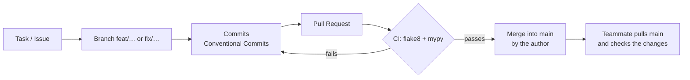

# Team organization

## Team

| Login | GitHub | Main role |
| --- | --- | --- |
| **rpetit** | 69Nesta | Game design & UI mockups (Figma), config & data, game logic core, menus, packaging |
| **lgirard** | B4nJuice (also commits as *Bananoo* from the GitHub web UI) | Rendering engine, gameplay mechanics, ring progression, in-game UI |

## Who did what

Built from the commit history (`git log`), grouped by area.

### rpetit (69Nesta)

- **Design**: [Figma mockups](https://www.figma.com/design/cSfGNa7qtEZC10juktc8Ys/42---Pakman?node-id=0-1&t=foPbcMUUIEDrhbBq-1)
  of the game and of every interface (lobby, HUD, pause, level-up, cheat, victory, game
  over, leaderboard, settings, how to play); colors used as the config defaults.
- **Setup**: `uv` project, dependencies, `.gitignore`, mypy/flake8 as dev dependencies.
- **Configuration**: `ConfigModel`, `ConfigManager` (comment parser for `#`, `//`, `/* */`,
  per-key fallback to defaults with logs), `json5` parsing, config passed as CLI argument.
- **Logger** with colors and pydantic warnings.
- **Maze**: integration of the assigned `mazegenerator` package, `Maze` and `Level` classes,
  `Tile`, move cache.
- **Entities**: `Entity`, `Movable`, `Displayable`, `MeshLayer`, `EntityStore`, first
  `Player` and `Ghost` classes.
- **Ghost AI**: `AI` base class, **A\*** path-finding, Blinky and Pinky, `GhostState`,
  `StateManager` (frightened phase), ghost death / frightened textures.
- **Assets**: texture pack system (`TexturePack`, `TextureLoader`, `TextureManager`,
  animations and variants), font management, character and item sprites.
- **Data**: leaderboard core with HMAC signature, settings (`SettingsManager`), key bindings
  (`KeyManager`, `ActionKey`).
- **UI**: `Button` / themes, lobby, victory, game over, how to play, leaderboard, settings
  (controls rebinding, resolution, texture packs), save run, cheat menu.
- **Delivery**: PyInstaller build (`pak-man.spec`, `make build`), itch.io page.

### lgirard (B4nJuice)

- **Setup**: Makefile, GitHub Actions workflow (flake8 + mypy), pytest tests for the config.
- **Rendering engine**: first CPU drawing functions (`put_pixel`, `put_line`,
  `put_polygon`), then the **GPU renderer** (moderngl, GLSL shaders, ping-pong
  framebuffers, blending, anti-aliasing), `Screen`, meshes (line, polygon, circle, image,
  text), `SuperMesh` widgets (bar, rectangle, font sequence, `MeshLevel`).
- **In-game UI**: `GameInterface`, `StatsInterface`, lives bar, level bar, timer display,
  pause menu, mouse click / hover system, `InterfaceManager`.
- **Gameplay**: collisions, `PacGum` / `SuperPacGum`, `Alive`, `Edible`, `PlayerState`,
  eating ghosts in super mode, death and respawn, Inky and Clyde, ghost path cheat
  (wall hack), timer, level list and next level, game over / victory connection.
- **Ring progression**: `Amelioration`, `Skill`, rarities, Speed / Exp / Super-time / Luck /
  Power rings, level-up interface and ring cards, skills panel.
- **Window**: resizable window, fullscreen, mouse position on a scaled screen.
- **Code quality**: norm and mypy clean-up passes, PEP 257 docstrings.

### Together

- Splitting the subject into tasks and choosing the architecture.
- Following each other's pull requests and fixing merge conflicts.
- Final testing, bug fixing and documentation.

## Workflow

- **Branches**: one per feature or fix (`feat/leaderboard-core`, `fix/lag`,
  `refactor/texture-managments`, …). `main` always stays playable.
- **Commits**: Conventional Commits (`feat:`, `fix:`, `refactor:`, `chore:`, `style:`).
- **Pull requests**: ~90 PRs merged. Most of them (87 of 91) were merged by their author
  once the CI passed; the other teammate followed the changes on GitHub and in our syncs.
  For a team of two working on separate areas, this kept us fast while CI protected `main`.
- **Issues**: bugs and TODOs were moved from code comments to GitHub Issues
  (commit `fix: TODO -> github issues`, 2026-10-08).
- **CI**: GitHub Actions runs `flake8` and `mypy` on every push to `main` and every PR.

## Communication and decisions

- **Syncs** in person at 42 and on **Discord**: what each one is doing, what is blocked,
  what comes next.
- **Task split by area** (engine / logic / UI / data) to limit merge conflicts: we rarely
  worked on the same files at the same time.
- **Decisions** that impact both of us (architecture, renderer, ring system, highscore
  format, file layout) were discussed together before coding; the person in charge of the
  area made the smaller choices.
- **Figma as the reference** for the UI: when we disagreed on a screen, the mockup was
  updated first, then implemented.

## How issues were handled

1. A bug found while testing is reported on GitHub Issues (or directly on Discord for
   small ones).
2. The owner of the area fixes it in a `fix/…` branch; if it blocks the other person, it
   is fixed first.
3. The fix goes through a PR like any feature, so it passes the CI and stays visible to
   the other teammate.
4. Merge conflicts were solved by the author of the PR, with the help of the other teammate
   when the conflict touched their code.
