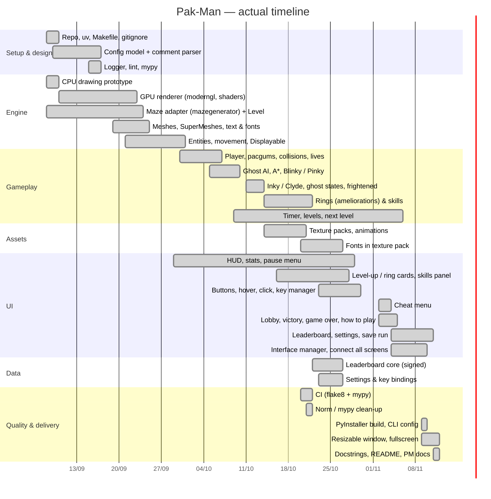
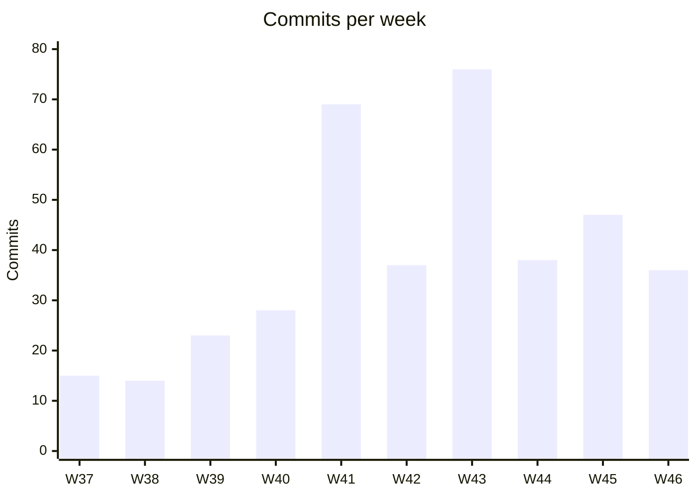

# Timeline

The dates below are the **actual** dates, rebuilt from the git history (first and last
commit of each block of work).

## Gantt chart

## Milestones

| Date | Milestone |
| --- | --- |
| 2026-09-08 | Project created, assigned maze package integrated |
| 2026-09-15 | Config system done (comments, fallback to defaults, no traceback) |
| 2026-09-23 | First maze displayed on screen with the GPU renderer |
| 2026-09-30 | Player and entities moving in the maze |
| 2026-10-08 | **First playable version**: eat pacgums, lose lives, eat ghosts in super mode |
| 2026-10-11 | 4 ghosts with their own AI |
| 2026-10-21 | Texture packs, CI green (flake8 + mypy) |
| 2026-10-26 | Leaderboard and settings cores |
| 2026-11-04 | All menus built (lobby, victory, game over, how to play, leaderboard) |
| 2026-11-09 | **Full game loop connected**, first packaged build |
| 2026-11-11 | Docstrings, README and project-management documents |

## Weekly activity (commits, merges excluded)

| Week | Dates | rpetit | lgirard | Main focus |
| --- | --- | ---: | ---: | --- |
| W37 | 08/09 – 14/09 | 4 | 11 | Setup, drawing prototype, maze package |
| W38 | 15/09 – 21/09 | 9 | 5 | Config, logger, GPU renderer, image mesh |
| W39 | 22/09 – 28/09 | 10 | 13 | Maze display, text, Displayable, MeshLayer |
| W40 | 29/09 – 05/10 | 11 | 17 | Entities, player, HUD, pause, first ghost |
| W41 | 06/10 – 12/10 | 29 | 40 | A\*, ghost AI, collisions, lives, super mode, timer |
| W42 | 13/10 – 19/10 | 15 | 22 | Ghost states, rings, texture packs, animations |
| W43 | 20/10 – 26/10 | 29 | 47 | CI, mypy, leaderboard, settings, buttons, level-up UI |
| W44 | 27/10 – 02/11 | 10 | 28 | Hover / click, optimisation, cheat menu |
| W45 | 03/11 – 09/11 | 29 | 18 | All menus, interface manager, levels, build |
| W46 | 10/11 – 11/11 | 17 | 19 | Fixes, fullscreen, docstrings, documentation |

## Progress analysis

- **Weeks 1–4**: most of the time went into the **rendering engine**. Writing our own GPU
  renderer was slower than using a game library, but it was needed to respect the
  "MLX-like functions only" rule and it made every later UI screen easier.
- **Week 5 (W41)** was the turning point: the game became playable, and the ghost AI was
  done in a few days thanks to the `Maze` / `AI` / `A*` base built before.
- **Weeks 6–8**: we added our own **ring progression** system; this was extra work beyond
  the subject, which pushed the menus to the end of the project.
- **Weeks 8–9**: menus were built quickly from the Figma mockups and the shared `Button`
  widgets; the last days were used for connecting every screen, packaging and documentation.
- What we would do differently: build a minimal version of all menus earlier, to test the
  full game loop (menu → game → highscore → menu) sooner.
